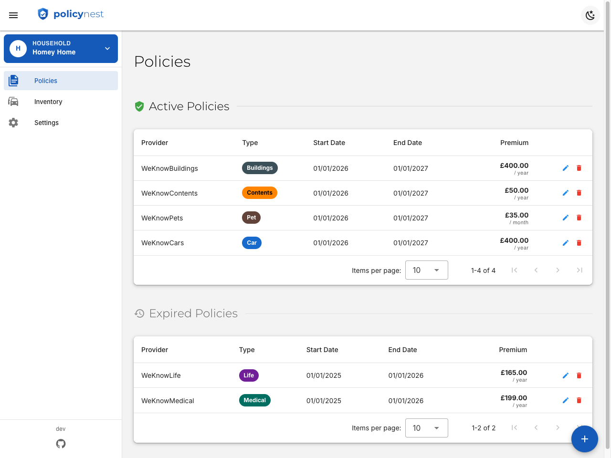
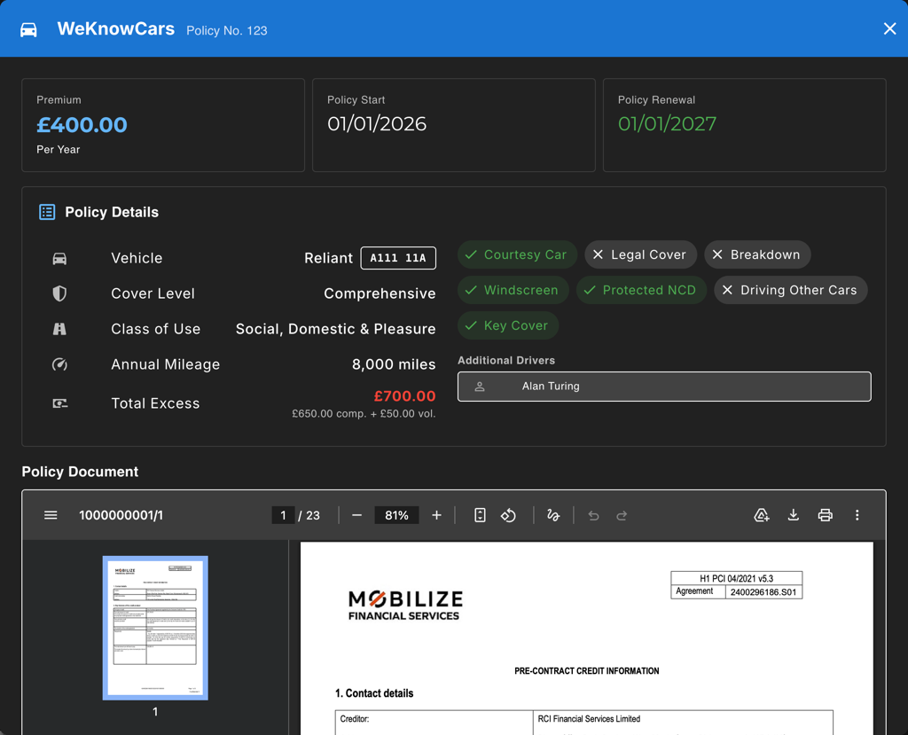
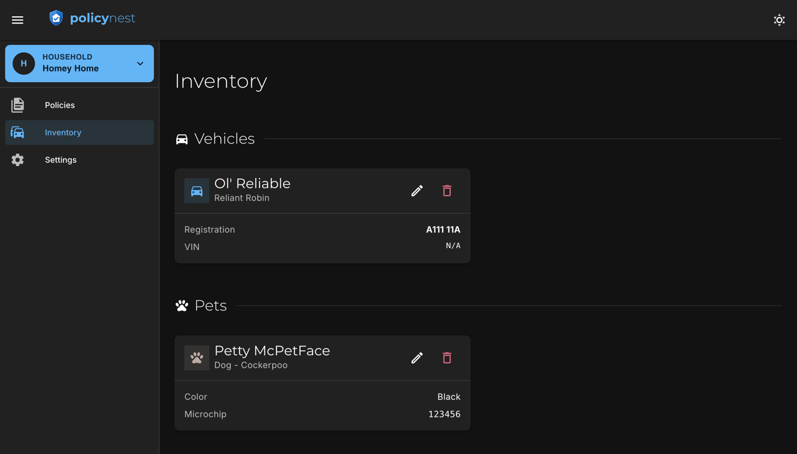
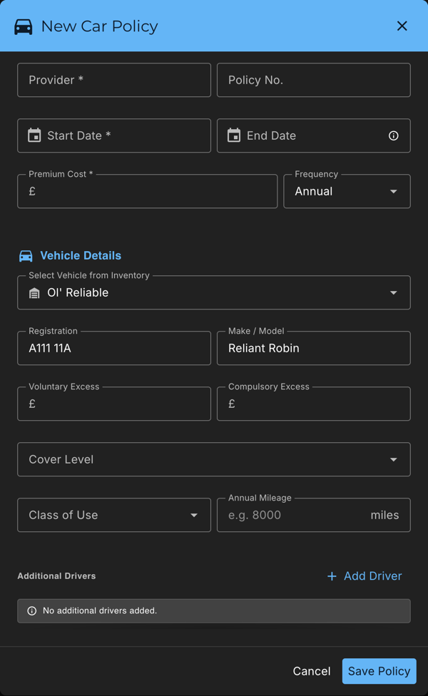

# PolicyNest

> **Stop digging through email attachments.** Keep your family's policy documents safe, organized, and fully under your control.


A modern, containerized application to track insurance policies (**Buildings**, **Car**, **Contents**, **Life**, **Medical**, and **Pet**) and household assets (**Vehicles** and **Pets**) across multiple households. Built for self-hosters who value privacy and data ownership.



## Features

* **Multi-Household Support:** Create, switch, rename, and delete households (with safeguards for the last household) from a single instance.
* **Asset Inventory:** Manage **Vehicles** and **Pets**, link them directly to Car and Pet policies, add them inline from policy forms, or save free-text entries to Inventory when creating a policy.
* **Type-Specific Policies:** Tailored forms and detail views for Buildings, Car, Contents, Life, Medical, and Pet insurance, separated into **Active** (including perpetual) and **Expired** sections.
* **Document Storage:** Upload, replace, and preview policy PDFs directly in the browser.
* **Localization & Formatting:** Choose display currency (`GBP`, `EUR`, `USD`, `AUD`, `CAD`) and browser-default or custom date/number locale formatting (`en-GB`, `en-US`, `en-AU`, `en-CA`, `ISO 8601`, `de-DE`, `fr-FR`).
* **System / Light / Dark Mode:** Responsive UI following your OS preference by default, with navbar quick toggle and 3-state selector in Settings.
* **Single-Container Deployment:** Multi-stage Docker image serving the built Vue SPA, API, and uploads from FastAPI/Uvicorn on a single port.

## Screenshots

_Policy details_



_Creating household assets_



_Create new Car insurance policy_



More screenshots are available in [docs/img](./docs/img/)

---

## Quick Start (Docker Compose)

This is the recommended way to run the application.

1. **Create or use `docker-compose.yml`**

   Build locally from this repository (default in [`docker-compose.yml`](./docker-compose.yml)):
   ```yaml
   services:
     policynest:
       build: .
       container_name: policynest
       ports:
         - 8000:8000
       volumes:
         - ./data:/data
       restart: unless-stopped
   ```
   Or replace `build: .` with `image: splinterhead27/policynest:latest` to run a published image.

2. **Start the stack**
   ```bash
   docker compose up -d --build
   ```
   *(Or run `just run` / `just stop` via the root [`Justfile`](./Justfile).)*

3. **Access the App**
   * **Frontend & API:** `http://localhost:8000`
   * **Backend API Docs (Swagger UI):** `http://localhost:8000/docs`

4. **First Run:** You will be prompted to create your first **Household** (e.g., *The Smith Residence*) to initialize your workspace.

---

## Roadmap

- [x] **Assets Layer:** Attach Car and Pet policies to Vehicle and Pet inventory assets.
- [ ] **Authentication:** Add user login support.
- [ ] **Database Integration:** Switch from SQLite to PostgreSQL for larger deployments.
- [ ] **Renewal Alerts:** Email notifications when a policy is ending.

---

## Development Setup

If you want to contribute or run the app locally without Docker:

* **Requirements:** Python `>=3.14` (Docker uses `python:3.15-slim`), [Poetry](https://python-poetry.org/), Node.js `^20.19.0 || ^22.13.0 || >=24` (Docker uses `node:26-alpine`), and optionally [`just`](https://github.com/casey/just).

### Quick Install & Formatting (`just`)

```bash
just install   # Installs backend Poetry deps and frontend npm deps
just fmt       # Runs isort + black on backend and Prettier on frontend
```

### Frontend (Vue 3.5 + Vuetify 4 + Vite 8)

```bash
cd frontend
npm install
npm run build   # Builds dist/ served by FastAPI on :8000
npm run lint    # Runs ESLint (use `npx eslint . --max-warnings 0` for strict check)
npm run format  # Formats src/ with Prettier
npm run dev     # Starts standalone Vite dev server (no /api proxy configured)
```

### Backend (FastAPI + Poetry)

`POLICYNEST_DATA_DIR` defaults to `/data`, so point it to `../data` when running locally outside Docker:

```bash
cd backend
poetry install --no-root
POLICYNEST_DATA_DIR=../data poetry run alembic upgrade head
POLICYNEST_DATA_DIR=../data poetry run uvicorn app.main:app --reload
```

With `frontend/dist` built and Uvicorn running, open `http://localhost:8000`.

---

## Architecture

PolicyNest runs as a single monolith container built via multi-stage [`Dockerfile`](./Dockerfile):

* **Frontend:** Vue 3.5, Vuetify 4.3, Vue Router 5, Axios, built with Vite 8 and served from `frontend/dist` by FastAPI (`/` SPA routes, `/assets/*`, and cached static assets such as `/favicon.ico`).
* **Backend:** FastAPI 0.165, Pydantic 2.14, SQLAlchemy 2.1 ORM, Alembic 1.20 migrations, running on Uvicorn 0.54 (Python 3.15 in Docker).
* **Database:** Local SQLite (`policynest.db` inside `POLICYNEST_DATA_DIR`, defaulting to `/data`).
* **Storage:** Uploaded PDF policy documents stored under `${POLICYNEST_DATA_DIR}/uploads` and served at `/data/uploads`.

### Directory Structure

```text
PolicyNest/
├── backend/
│   ├── alembic/              # Alembic migration environment & versions
│   ├── app/
│   │   ├── routes/           # API routers (asset, household, policy, system)
│   │   ├── database.py       # SQLite engine & POLICYNEST_DATA_DIR setup
│   │   ├── main.py           # FastAPI app, API router, uploads & SPA serving
│   │   ├── models.py         # SQLAlchemy ORM models
│   │   ├── schemas.py        # Pydantic request/response schemas
│   │   └── uploads.py        # PDF upload storage helpers
│   ├── alembic.ini
│   ├── Justfile
│   └── pyproject.toml        # Poetry dependency management
├── frontend/
│   ├── public/               # Static assets (favicon.ico)
│   ├── src/
│   │   ├── components/       # Shared dialogs, nav shell, policy forms & details
│   │   ├── router/           # Vue Router configuration
│   │   ├── services/         # Axios API client (/api)
│   │   ├── utils/            # Policy/Asset type metadata & locale formatters
│   │   └── views/            # Page views (Policies, Inventory, Settings)
│   ├── index.html
│   ├── Justfile
│   ├── package.json
│   └── vite.config.js
├── docs/img/                 # README screenshots
├── docker-compose.yml
├── docker-entrypoint.sh      # Runs `alembic upgrade head` then starts Uvicorn
├── Dockerfile                # Multi-stage Node 26 + Python 3.15 build
└── Justfile                  # Root install, format, and Docker compose tasks
```

---

## Contributing

Pull requests are welcome. For major changes, please open an issue first to discuss what you would like to change.

---

## License

[MIT](https://choosealicense.com/licenses/mit/)
